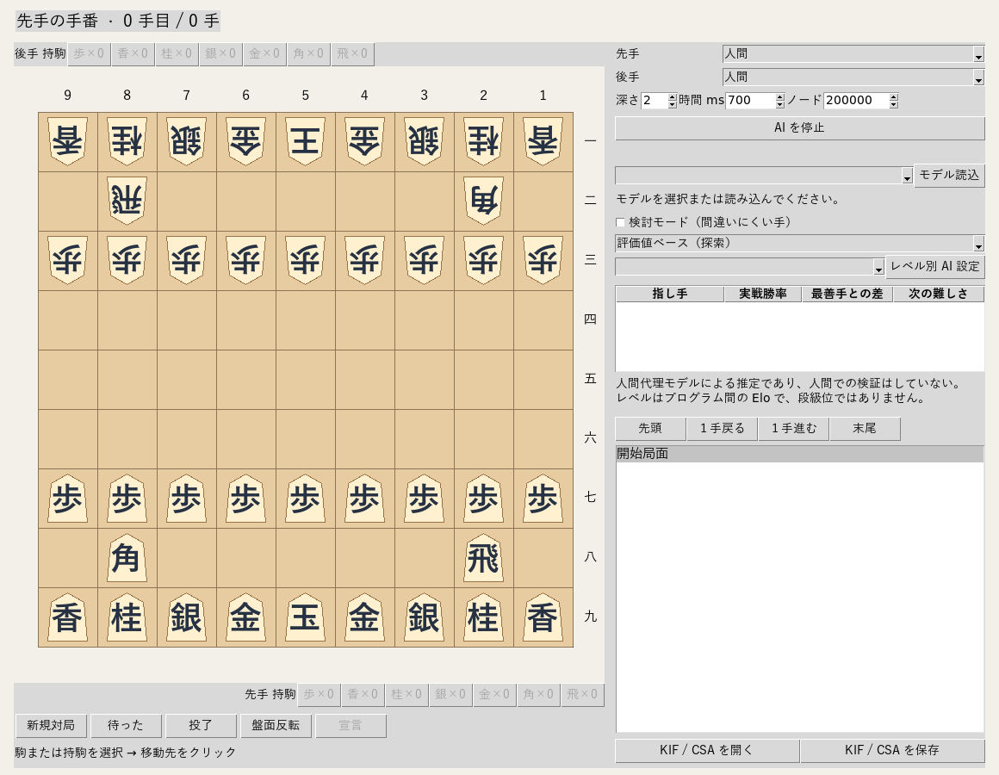
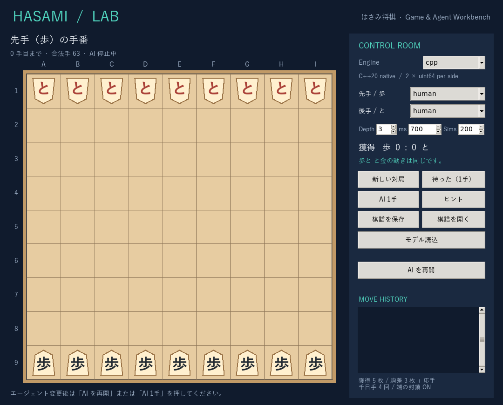

# Hasami Lab

English summary: Game engines, Tk GUIs, USI and self-play training code. Published model cards report training records and results under recorded evaluation conditions.

将棋・はさみ将棋を遊び、自己対戦で学習し、候補手の判断方法を実験する Python / C++ のコードです。[公開リポジトリ](https://github.com/shila24/hasmishogi)に学習コードも含みます。将棋の検討機能には対応モデルが必要です。モデルの学習記録と取得方法は [モデル一覧](models/README.md) に掲載します。

Python と Tk が必要です。Windows では `python3` を `python` に読み替えます。

```sh
python3 launch_shogi.py --backend python
python3 launch_hasami.py --backend python
```

| ゲーム | GUI | USI | エンジン API | CLI | 学習コード | モデル |
| --- | --- | --- | --- | --- | --- | --- |
| 将棋 | あり（Tk） | あり | Python / C++ | `python -m shogi.cli` | あり | 任意ダウンロード: shogi-alphazero-iter30, nnue-factorised |
| はさみ将棋 | あり（Tk） | — | Python / C++ | `hasami_cli`（C++ ビルド後） | あり | 任意ダウンロード: hasami-alphazero-iter44 |
| リーチ麻雀 | — | — | Python / C++ | `python -m riichi.cli` | あり | 組込みエージェント |
| ポーカー | — | — | Python | — | あり | 組込みエージェント |
| 人狼 | — | — | Python | — | あり | 組込みエージェント |

- [インストール](docs/INSTALL_ja.md)・[操作方法](docs/USAGE_ja.md)
- [将棋所 / ShogiGUI 接続](docs/SHOGIDOKORO_ja.md)
- [学習と自律ループ](docs/TRAINING_ja.md)・[進捗と診断](docs/PROGRESS_ja.md)
- [手法と測定範囲](docs/METHOD_ja.md)・[評価結果](docs/RESULTS.md)
- [コード案内](docs/CODE_GUIDE_ja.md)・[モデル](models/README.md)・[引き継ぎ](docs/HANDOFF_ja.md)



2026-11-16、WSL2 の仮想画面で実 GUI を撮影した将棋の初期局面です。



同日のはさみ将棋 GUI。ルールは `hasami-lab-v1`。五枚捕獲で勝ち、三枚差には一回の応手があり、その応手で差を三未満へ戻す必要があります。四枚差から一枚取り返しても負けです。

コードと配布モデルのライセンスは MIT。重みは Releases のモデルアセットとして取得します。`SOURCE_COMMIT` にソースの版を記録します。
