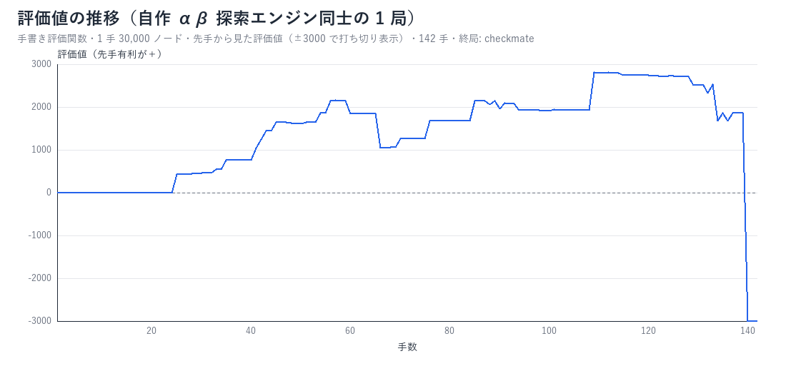

# 手法と測定範囲

English summary: The distribution implements AlphaZero-style learning, native alpha-beta/NNUE training and practical-move advisors. Recorded runs remain weak; no strength or human-benefit claim is made. Unmeasured implementations and planned safety research are distinguished below.

## 実装された方法

| 系統 | 配布コードと実装 | 測定範囲 |
| --- | --- | --- |
| 規則 | Python と C++ のはさみ将棋・将棋・麻雀、Python のポーカー・人狼、ゲームアダプター | テストは規則と接続の検証です。棋力ではありません |
| Z | `algorithms/alphazero.py`、ResNet / MLP、Python / native PUCT MCTS、Gumbel root selection と sequential halving、root value 混合 target | 下のはさみ将棋 run 以外の効果は実装済み・未計測 |
| N | `cpp/shogi_search/` の反復深化 PVS、quiescence、TT、手順付け、pruning、手書き評価、NNUE float 推論 | 下の対局と六つの候補を測定。それ以外の強さは実装済み・未計測 |
| NNUE 学習 | `hasami_learn/nnue/` の疎な king-relative 特徴、incremental accumulator、自己対戦データ生成、結果＋探索値の教師、game 単位分割、蒸留、再開可能なループと match gate | 六つの候補はいずれも昇格せず。より長い学習の結果は未計測 |
| その他の学習 | 教師あり、DQN、PPO、REINFORCE、敵対的リーグ、複数席の自己対戦 | 実装済み・未計測（tiny は接続確認） |
| 助言 A | `practical_search.py` の代理プレイヤー上の expectimax、評価差 guard、難しさ推定。隠れ情報は `practical_general.py` で標本化 | 実装済み・未計測（実際の人間への効果） |
| 比較 B / C | `algorithms/practical.py` の追加学習 / 同時学習、`practical_eval.py` の E1–E8 | 実装済み・未計測（製品規模の比較） |
| 両系統の共通助言・安全評価 | 同一条件の両系統比較、E9、独立した safety critic、method S、実際の人による確認 | 予定。現在の GUI の安全保証ではありません |

N 系の TT は手順履歴の影響を完全には表せない近似を含みます。反復を probe 前に検査し、反復由来の score を保存しない扱いです。はさみ将棋では履歴を無視した TT score 再利用を行いません。NNUE の整数量子化 / AVX2 による高速化は予定です。

## 間違えにくい候補手という目的

目的は、評価を保つだけでなく、その後も指し継ぎやすい候補を調べることです。A はモデルの評価に見落とし・迷いを加えた代理プレイヤーから先の期待得点を推定し、最善手から落としすぎる候補を除きます。代理レベルは人間の段級位を表しません。B/C は比較用の学習方式です。人間の棋譜や外部モデルを教師として使っていません。人間への有効性や研究上の新規性は主張しません。

安全評価では、許容手の数と確率質量、最善手から次善手への急落、証明された近い詰み、玉の薄さを価値とは別に扱うことを計画しています。未証明の詰み探索を「安全」と扱わず、将来の cost critic は自己対戦での崩壊・被詰み等を学習し、未使用の局で校正する予定です。現時点で学習された安全性やリスク低減を保証しません。

## 記録された例

手書き評価 αβ 同士、一手 30,000 nodes、142 手で詰みになった一局の評価推移です。139 手付近で急落しています。一局から一般的な棋力や安全性は判断できません。図は記録から 2026-11-16 に作成しました。

3,619,695 局面のデータに関係する六つの 400 局対戦結果です。候補の昇格はありません。図の比較条件の範囲の測定であり、条件の異なる run の差を一つの要因の効果と解釈しません。

AlphaZero の 44 反復 checkpoint 同士の対戦。random に約 0.6–0.7 score、深さ 1 αβ に 0/20 の弱いモデルです。2026-11-16、WSL2 の仮想画面で実 GUI を撮影しました。重みはこの配布物には含まれません。

将棋の学習済みモデルはまだないため、候補手を示す検討モードの表の画像はありません。公開モデルの有無は [RESULTS](RESULTS.md) と索引で確認してください。
