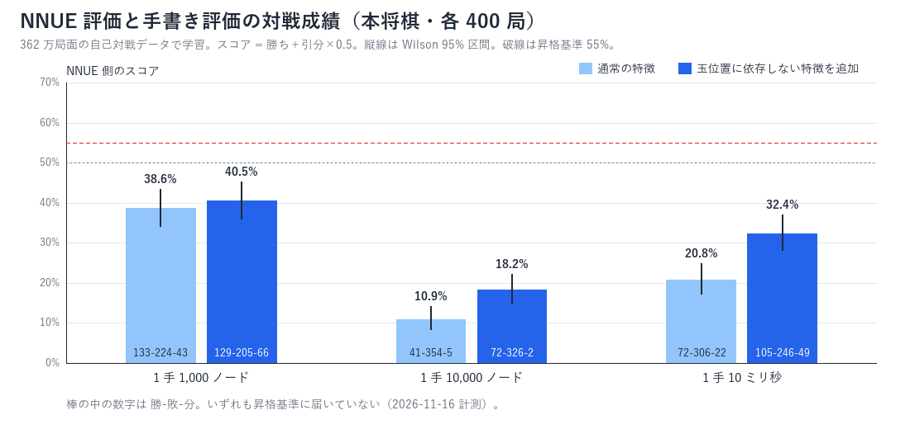
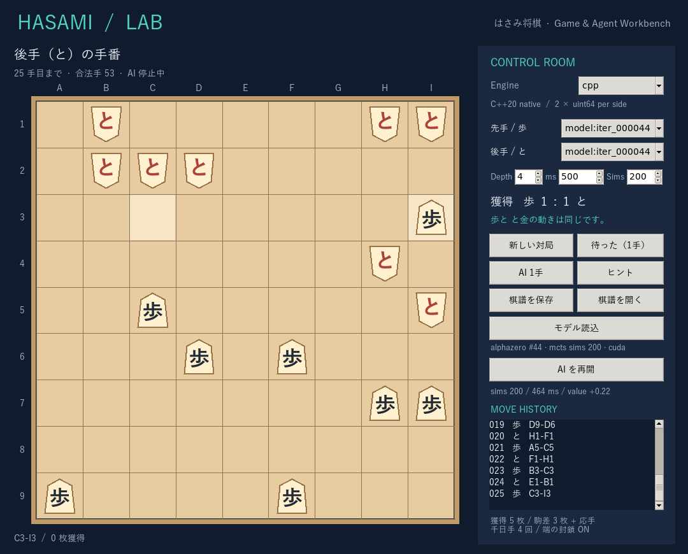

# 手法と測定範囲

English summary: AlphaZero-style policy/value learning, native alpha-beta search with NNUE evaluation, and practical-move advisors. Model cards report recorded training and match results.

## 実装された方法

| 系統 | 配布コードと実装 | 利用方法・記録 |
| --- | --- | --- |
| 規則 | Python と C++ のはさみ将棋・将棋・麻雀、Python のポーカー・人狼 | 規則・接続テストを収録 |
| AlphaZero | `algorithms/alphazero.py`、ResNet / MLP、Python / native PUCT MCTS、Gumbel root selection、sequential halving | 方策・局面評価を自己対戦から学習。反復数と対局結果はモデルカードに記録 |
| ネイティブ探索 | `cpp/shogi_search/` の反復深化 PVS、quiescence、TT、手順付け、pruning | 手書き評価または NNUE 評価で探索 |
| NNUE 学習 | `hasami_learn/nnue/` の king-relative 特徴、incremental accumulator、自己対戦データ生成、結果＋探索値の教師、game 単位分割、蒸留 | `hlnnw1` 重みを `EvalFile` で指定。各探索予算の対局結果は [RESULTS](RESULTS.md) |
| その他の学習 | 教師あり、DQN、PPO、REINFORCE、敵対的リーグ、複数席の自己対戦 | tiny 設定で学習・保存・推論の接続を確認 |
| 助言 A | `practical_search.py` の代理プレイヤー上の expectimax、評価差 guard、難しさ推定。隠れ情報は `practical_general.py` で標本化 | モデル上の期待得点と候補手を表示 |
| 比較 B / C | `algorithms/practical.py` の追加学習 / 同時学習、`practical_eval.py` の E1–E8 | 比較実験用の設定と評価コードを収録 |

N 系の TT は手順履歴の影響を近似します。反復を probe 前に検査し、反復由来の score は保存対象から除外します。はさみ将棋のキャッシュは手順のヒントを扱います。NNUE は float32 で推論します。

## 間違えにくい候補手という目的

A はモデルの評価に見落とし・迷いを加えた代理プレイヤーから先の期待得点を推定し、評価差の条件を満たす候補を表示します。代理レベルはプログラム同士の対局に基づきます。B/C は比較用の学習方式です。学習データの出所は自己対戦です。

安全評価の研究計画では、許容手の数と確率質量、次善手への評価の落差、近い詰み、玉の薄さを価値と併せて扱います。実装・実験の記録は、それぞれの条件と数値に基づいて記述します。

## 記録された例

手書き評価 αβ 同士、一手 30,000 nodes、142 手で詰みになった一局の評価推移です。図は記録から 2026-11-16 に作成しました。

3,619,695 局面のデータに関係する六つの 400 局対戦結果を図示しています。各結果は図に記した条件での測定です。配布する重みについては、重みの SHA256 に結び付いた [実測表](RESULTS.md) を参照してください。

AlphaZero の 44 反復 checkpoint 同士の対戦。2026-11-16、WSL2 の仮想画面で実 GUI を撮影しました。モデルの学習記録・対戦相手別の実測は [モデル一覧](../models/README.md) から確認できます。
