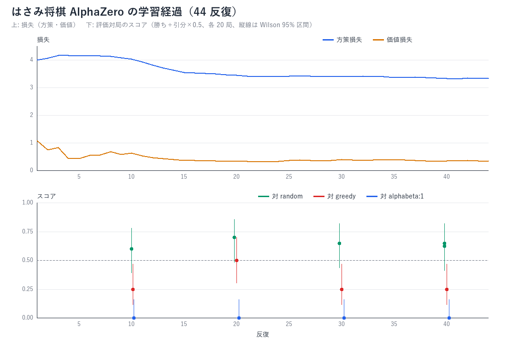

# 進捗と診断

English summary: The standard-library progress monitor reads recorded metrics; diagnostics inspect a checkpoint. Loss is not playing strength. Truncation is reported separately from game outcomes.

学習実行フォルダは `runs/release-smoke/` の下の `config.json` と `metrics.jsonl` があるフォルダです。次の `<run>` はそのフォルダ、`<checkpoint>` は保存された checkpoint に置き換えます。

```sh
python3 -m hasami_learn.progress summary --run <run> --json
python3 -m hasami_learn.progress html --run <run> --out /tmp/hasami-progress.html
python3 -m hasami_learn.progress watch --loop runs/autoloop-tiny/tiny-hasami --out /tmp/hasami-progress.html --interval 30 --refresh 30 --once
.venv/bin/python -m hasami_learn.diagnostics --checkpoint <checkpoint> --run <run> --out /tmp/hasami-diagnostics.json --device cpu --positions 4 --simulations 0 2
.venv/bin/python -m hasami_learn.cli eval --checkpoint <checkpoint> --opponent random --games 2 --device cpu
```

Linux/WSL と macOS は同じ Python コマンドです。Windows は `python` / `.venv\Scripts\python.exe` を使い、`/tmp/` を書込可能なローカル出力先に置き換えます（Windows・macOS は今回未実行）。HTML はブラウザーで開きます。WSL からの `explorer.exe` / `wslview` 起動は今回未実行です。`watch` から `--once` を外すと継続監視し、Ctrl+C で止めます。

進捗モニターは標準ライブラリだけで動き、学習を起動・停止しません。同じ種別・反復の後の行を採用し、欠損・非有限値をグラフに描きません。2,000 点以上の系列は描画だけ間引きます。保存済みステータスは生存確認ではありません。推定残り時間は直近 collect＋update の平均で、評価・保存時間は含みません。

| 記録 | 読み方 |
| --- | --- |
| loss | 学習目的への適合。棋力とは別です |
| eval score | `(勝ち + 0.5 × 引分) / 局数`。相手と区間、打切数を併記して比較します |
| collect wins | 席別の勝数。学習者の勝率ではありません |
| truncated | 実験上の手数上限。ルールによる引分とは別です |
| diagnostics | 方策・価値・探索・戦術プローブ。成功を仮定せず出力値を読みます |



2026-11-16 作成の図。はさみ将棋 AlphaZero の 44 反復の記録です。この run は random に約 0.6–0.7 score、深さ 1 の αβ に 0/20 でした。損失の低下から強さを主張しません。
