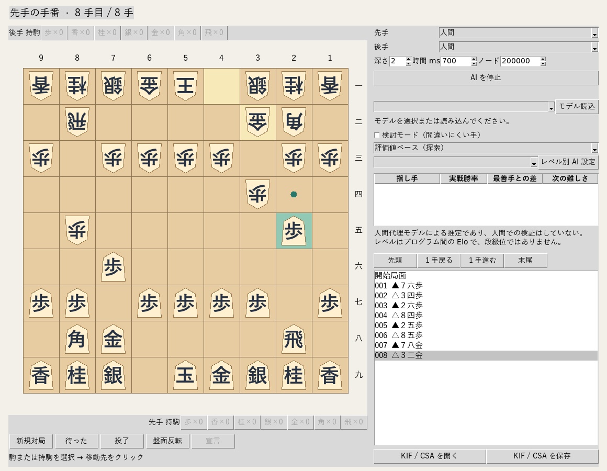
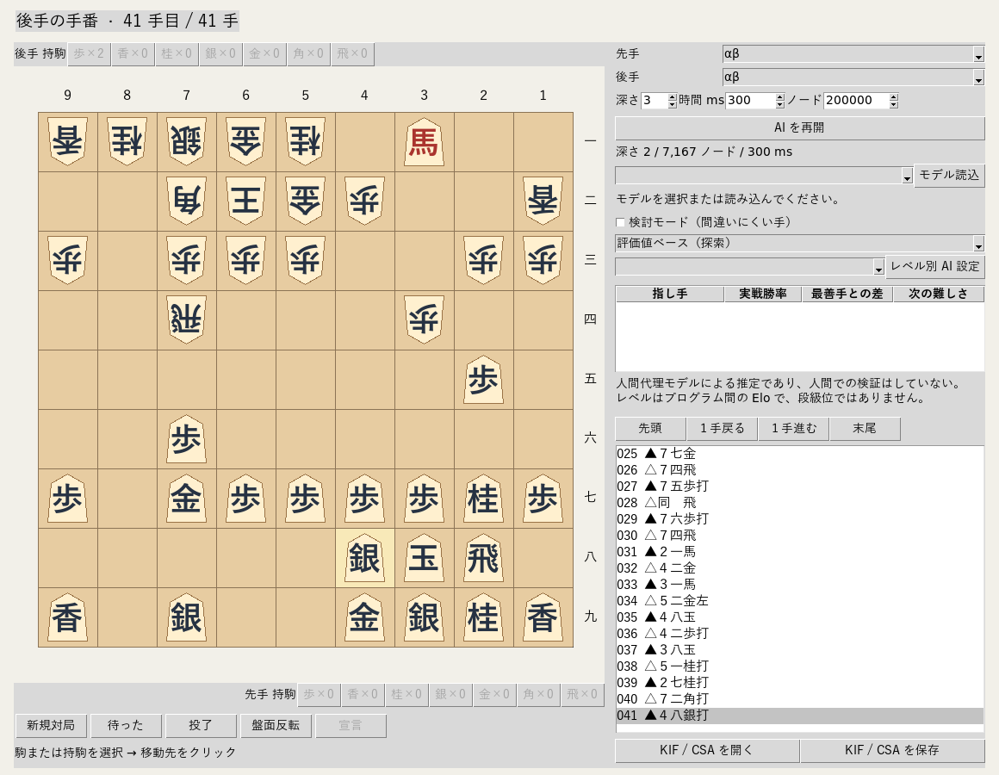
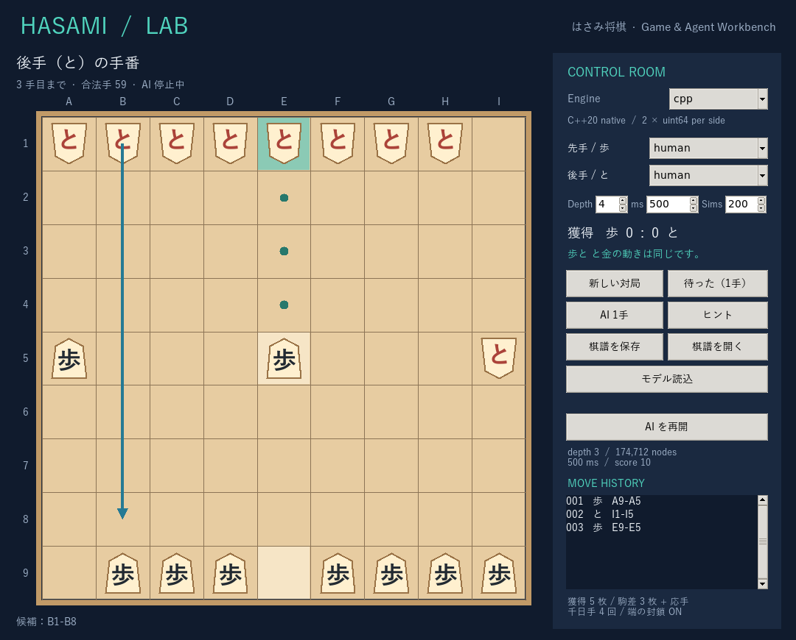
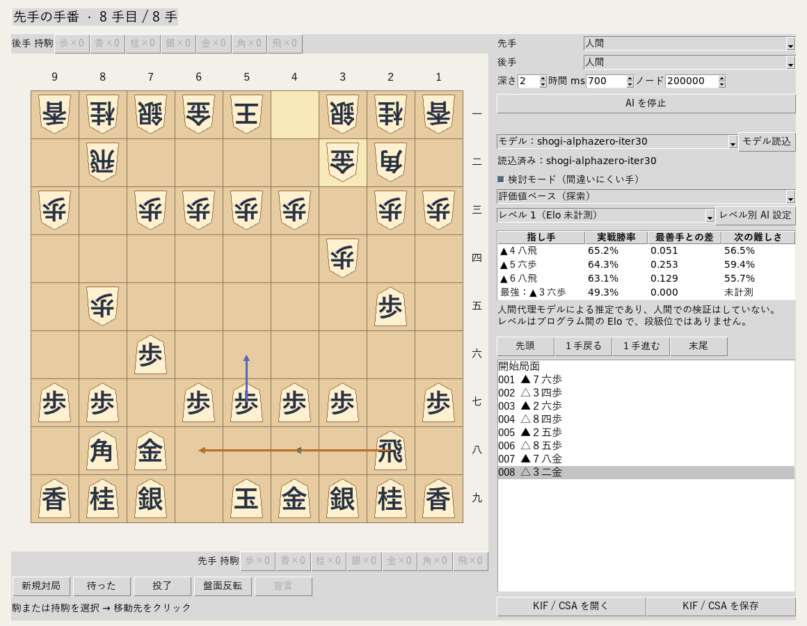

# 遊び方

English summary: Installation, usage and verification commands for this distribution.

## 起動（リポジトリのルートから）

Linux / WSL2 / macOS:

```sh
python3 launch_hasami.py --backend python
python3 launch_shogi.py --backend python
```

Windows:

```powershell
python launch_hasami.py --backend python
python launch_shogi.py --backend python
```

Linux の画面操作は仮想画面でも確認できます。

## はさみ将棋

```sh
python3 launch_hasami.py --backend python
```

盤面の下側が先手「歩」、上側が後手「と」です。自分の駒をクリックし、点で示された移動先をクリックします。駒は縦横に空いているマスまで動き、ほかの駒を飛び越えられません。

先手・後手ごとにプレイヤーを選べます。

| 選択 | 動作 |
| --- | --- |
| human | 人が操作する |
| random | 合法手から無作為に選ぶ |
| greedy | すぐ取れる駒を優先する |
| alphabeta | 先の手を探索する |

両側を AI にすると観戦できます。選択を変更したら「AI を再開」を押します。これらの名前は組込み探索の方式を示します。Depth は古典探索の深さ、ms は探索時間の目安です。

「ヒント」は候補を矢印で示し、手は進めません。「AI 1手」は一手だけ進めます。人間の手番では古典探索が代わりに選びます。「待った」は一手戻して AI を止めます。人間の手番まで戻すには必要に応じてもう一度押してください。

棋譜は「棋譜を保存」「棋譜を開く」で JSON として扱います。読み込み時は着手を再生して検証します。

## モデルの利用

公開済みモデルは `models/index.json` に記録されています。取得方法は [モデル案内](../models/README.md) を参照してください。GUI の「モデル読込」から `models` 内のモデルフォルダを選び、追加されたプレイヤーを選択します。現在の GUI はこの手動読込方式です。

Sims は MCTS の探索回数の上限です。読み込み時の値も上限になるので、増やしたい場合はモデルを読み込み直します。モデルがない版でも古典的 AI を使えます。性能は [評価結果](RESULTS.md) の装置・対戦相手・対局数・区間と一緒に判断してください。

## 将棋

```sh
python3 launch_shogi.py --backend python      # C++ エンジンをビルドした場合は --backend cpp
```

本将棋（平手）です。千日手、連続王手の千日手、入玉宣言（CSA 27 点法）、320 手の最大手数に対応しています。

- **指し方**: 自分の駒をクリックすると合法な移動先が光ります。持駒は駒台から選んで、打てるマスをクリックします。
  成・不成の両方を選べるときだけ「成りますか？」が開きます。入玉宣言ができるときは「宣言」が有効になります。
- **対局者**: 先手・後手ごとに「人間」「ランダム」「貪欲」「αβ（深さ・時間）」、読み込んだ学習済みモデル、
  レベル別 AI から選べます。レベルはプログラム同士の対局から測った強さの目安（Elo）です。
  評価済みレベルには記録された測定値を表示します。
- **検討モード（間違いにくい手）**: 手番側について、選んだレベルの代理プレイヤーが指し継ぐ局面の期待得点を推定し、
  候補手を最大 3 手、盤上の矢印と一覧で示します。列は「実戦勝率」（代理プレイヤー上の期待得点）、
  「最善手との差」、「次の難しさ」（次の自分の手番で崩れやすいかの予測）です。判断方式の既定は「評価値ベース（探索）」で、
  比較用に「学習ベース」も選べます（対応するモデルがある場合）。この表示は代理プレイヤープログラム上の期待得点と難しさの推定です。
- **棋譜**: 右側の手順一覧で先頭・１手戻る・１手進む・末尾に移動できます。過去の局面から指すと、確認のうえで以降を
  置き換えます。KIF / CSA の読み書き、SFEN のコピー・貼り付け、新規対局（平手 / SFEN）、待った、投了、盤面反転があります。

### USI エンジン（ShogiGUI・将棋所など）

登録ファイル・Engine / EvalFile の設定と接続確認手順は [専用ガイド](SHOGIDOKORO_ja.md) を参照してください。

`python -m shogi.usi --backend cpp` をエンジンとして登録します。主なオプション:

| オプション | 内容 |
| --- | --- |
| `Model` | モデル名、またはチェックポイントのフォルダ |
| `Mode` | `strong`（最強設定）/ `practical`（間違いにくい手）/ `level`（レベル別 AI） |
| `Method` | `practical` の判断方式。既定 `search`（評価値ベース）、`learned`（学習ベース） |
| `Level` | `practical` と `level` で使うレベル |
| `Depth` / `MaxNodes` | 古典 αβ で使う探索量 |

持ち時間・秒読みから 1 手の時間を決め、`stop` で現在の最善手を返します。

## 操作の確認順

1. はさみ将棋の先手を human、後手を random にし、一手指します。後手を greedy、alphabeta に変更し、それぞれ「AI を再開」で対局します。新しい相手で初めから対局する場合は新規対局に戻します。
2. 将棋も先手を人間、後手をランダム、貪欲、αβの順に選んで指します。配布コードに含まれる組込み相手です。深さ・時間の値を変更して探索量を調節します。
3. 自分の駒または持駒を選び、表示された合法手の場所をクリックします。ヒントと待ったを確認します。
4. 公開モデルが索引に掲載されたときだけダウンロードし、learn/ai の依存を入れた Python で起動して「モデル読込」を使います。学習記録・評価条件はモデルカードに記載しています。



2026-11-16、WSL2 の仮想画面。実 GUI で駒を選択し、合法な移動先を表示しています。



同日の組込み αβ 対 αβ、41 手目です。



同日の実 GUI のヒント表示。候補は盤面を変更せず示します。

## コマンドライン

```sh
python3 -m shogi.cli perft --depth 2
python3 scripts/usi_smoke.py --classical-only
python3 scripts/benchmark.py --depth 2 --rounds 5
```

Windows は `python3` を `python` に読み替えます。モデルを使うコマンドは [.venv の導入](TRAINING_ja.md) 後に実行します。処理速度は棋力とは別です。



モデルを使った候補手の検討画面です。
